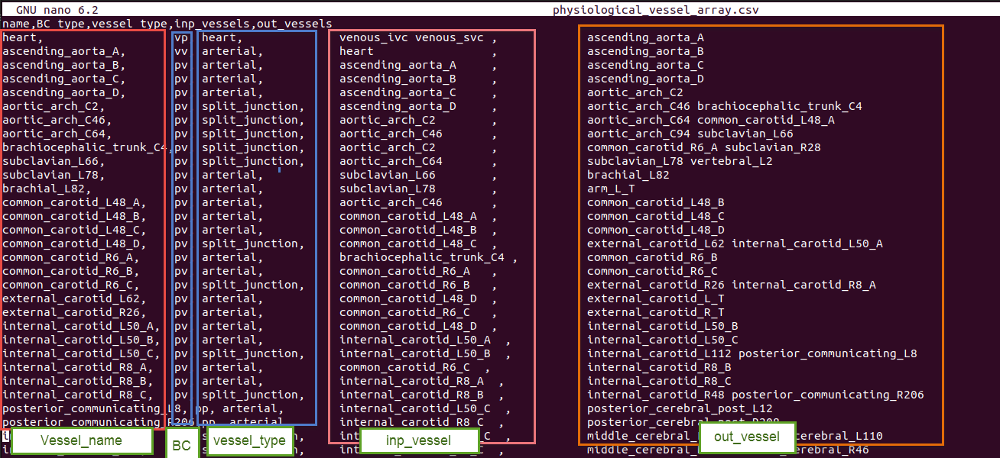

# Designing a model

This section describes how to design a model to be run in Circulatory Autogen. There are two sub sections included in this guide as follows.

1. [Creating a new model](#creating-a-new-model)

2. [Converting an existing CellML model to run in Circulatory Autogen](#converting-an-existing-cellml-model-to-run-in-circulatory-autogen)

## Prerequisites

- Familiarity with your CellML module structure.
- A place to store user modules and configs (`module_config_user/` or an external modules directory).

## Creating a new model

This software is designed so the user can easily make their own modules and couple them with existing modules. The steps are as follows.

1. Either choose an existing `[module_category]_modules.cellml` file to write your module, or if it is a new category of module, create a `[module_category]_modules.cellml` file in `[project_dir]/module_config_user/`.

2. Put your cellml model into the `[module_category]_modules.cellml` file.

3. Create a corresponding module configuration entry in a JSON file within `[project_dir]/module_config_user/`. The code loads all `*.json` files in `module_config_user` (and in `src/libcuflynx/generators/resources`), so you can name it with your category (e.g. `[module_category]_modules_config.json`). These module declarations detail the variables that can be accessed, the constants that must be defined, and the available ports of the module.

4. When possible, use units defined in `[project_dir]/src/libcuflynx/generators/resources/units.cellml`. If you need to define new units, define them in `[project_dir]/module_config_user/user_units.cellml` (or in an external modules directory; see below).

5. Include your new module into a `[CA_user_dir]/[file_prefix]_module_array.csv` file.

    !!! Note
        Modules that are connected as each others inputs and outputs will be coupled together with any ports with corresponding name. 
        
        For an example, if VesselOne has an exit_port 'vessel_port' and VesselTwo has an entrance_port 'vessel_port', they will be coupled with the variables declared in their corresponding 'vessel_port'. You must be careful when making a new module, that the modules it couples to only has matching port types for the ones that are necessary for coupling.

        Additionally, if a module has a general_port [port_name], it will couple to any entrance, exit, or general port in a connected vessel with the port name [port_name]. 

        Standard usage: entrance and exit ports are used for spatial connections (e.g. exit to entrance of a parent and daughter vessel), whereas general ports are used for non-spatial connections (e.g a port for a material property of a whole vessel)

6. Define model constants in a `[CA_user_dir]/[file_prefix]_parameters.csv` file. OR run the autogeneration, which will call an error and create a `[CA_user_dir]/[file_prefix]_parameters_unfinished.csv`. See [model generation and simulation](model-generation-simulation.md)

The following sections include more details on creating the above required files.

### Creating module_array and parameter files

This section discusses creating a module_array and parameters files to build a new desired model.

One standard module array file contains five important columns, described below. The names are PhLynx's (#163).

- **name** is the name of the module instance, often a common organ or part of the cardiovascular system.
- **module_type** is the module, which exists in the `[project_dir]/src/libcuflynx/generators/resources/*_modules_config.json` files, one of the `[project_dir]/module_config_user/*_config.json` files, or a module library.
- **module_subtype** is its variant: for a vessel, the type of the boundary condition at its input and output.
- **inp_instances** are the instances feeding this one.
- **out_instances** are the instances this one feeds.

The order of these lists matters for a module with more than one port of a type: its inputs take
its entrance ports of each `port_type` in the order `inp_instances` lists them, and its outputs
its exit ports in `out_instances` order (an instance with no port of that type is skipped). A
monolithic heart's three `vessel_port` entrances are `v_ivc`, `v_svc` and `v_pvn`, so its
vessel inputs are listed inferior vena cava, superior vena cava, pulmonary vein; its two exits
are the aorta and the pulmonary artery. The rows' order in the array does not matter. A port
left unconnected is a boundary condition, which needs a value in the parameters file; to leave
an earlier port out while connecting a later one, list a module that sets it in its place, e.g.
a `zero_flow` instance (`module_type` `zero_flow`, `module_subtype` `nn`) first among a heart's
vessel inputs for a heart with one vena cava.

Some examples of possible inputs

| Column name    | Possible inputs                                                                                               |
|----------------|---------------------------------------------------------------------------------------------------------------|
| name           | User defined, but it is better to use common names like 'heart', 'pvn', 'par', etc.                           |
| module_subtype | 'vv', 'vp', 'pv', 'pp', 'pp_wCont', 'pp_wLocal', 'nn' (linked to module_subtype in the modules config JSON files) |
| module_type    | 'heart', 'arterial', 'arterial_simple', 'venous', 'terminal', 'split_junction', 'merge_junction', '2in2out_junction', 'gas_transport_simple', 'pulomonary_GE', 'baroreceptor', 'chemoreceptor' (linked to module_type in the modules config JSON files)  |
| inp_instances  | name of the input instances, one (or more) of the names in the other rows                                    |
| out_instances  | name of the output instances, one (or more) of the names in the other rows                                   |

A module array with the columns `BC_type`, `vessel_type`, `inp_vessels` or `out_vessels` is refused; convert it once with `cuflynx-upgrade module-array [file]`.

#### JSON module arrays

The module array can also be a JSON file, `[file_prefix]_module_array.json`: a list of records, one per module instance.

```json
[
 {"name": "src", "module_type": "flow_src", "module_subtype": "nn", "inp_instances": [], "out_instances": ["coll"]},
 {"name": "coll", "module_type": "collector", "module_subtype": "nn", "inp_instances": ["src"], "out_instances": []}
]
```

A record uses these keys. `name` and the type and subtype are required. The input and output lists are optional JSON lists; a space-separated string is accepted too. A record may also name the parameterisation whose parameters it uses, `"parameterisation": "[name]"` (see [Module versions and parameterisations](#module-versions-and-parameterisations)). Other keys are allowed, and keys holding plain values become extra columns, as extra CSV columns do.

A CSV module array is read by converting each row to this record first, so a CSV and its JSON conversion generate byte-identical models. The generator looks for the module array in this order: `[file_prefix]_module_array.json`, then `[file_prefix]_module_array.csv`. A `[file_prefix]_vessel_array.json` or `.csv` is refused; `cuflynx-upgrade module-array [file]` renames and converts it.

To convert CSV arrays, run

```bash
python -m libcuflynx.utilities.config_schemas to-json resources/my_model_module_array.csv [more.csv ...]
```

This writes `my_model_module_array.json` next to each CSV, one record per line. From Python, use `libcuflynx.utilities.config_schemas.module_array_to_json(csv_path, json_path=None)`, and `read_module_array_records(path)` to read either a CSV or a JSON array as records.

JSON Schemas for the module array, for module config files and for the top level of obs_data files ship with the package, in `libcuflynx/schemas/`: `module_array.schema.json`, `module_config.schema.json` and `obs_data.schema.json`. libcuflynx checks every file against its schema when it reads it, so a file that an editor or PhLynx validates against the schema is one libcuflynx accepts. Errors name the file, the record (with its name) and the key, and say what the key is for.

Below figure is an example of a module_array file.



Every row of the module array file represents a specific part or module in the defined system. Therefore, each module needs several parameters for modeling and generating a CellML file.

These parameters should be inserted in the parameters file: `[resources_dir]/[file_prefix]_parameters.csv`.

This file has the structure as shown below.

| Column Name    | Description                                       |
|----------------|---------------------------------------------------|
| variable_name  | Parameter name: `[vessel_name]/[variable_name]`, or `[variable_name]` for a global (see below) |
| units          | Unit in the defined units in CellML's unit file   |
| value          | Value of parameter                                |
| data_reference | Reference of the parameter value. Typically in `[last_name][date][first_word_of_paper]` format for papers.  |

The following is an example of a parameter file.


!!! Note
    If you forget to add or insert any needed parameter in the file when you run the code, it shows you this message at the end:

    

    At this time, you should open the `[resources_dir]/[file_prefix]_parameters_unfinished.csv`, which will include the parameters which were not inserted in the file with *EMPTY_MUST_BE_FILLED* value and data_reference entries. You should add the parameter value and reference, then copy the line to the original [file_prefix].csv file. Or you can add the value in the _unfinished.csv file then remove the last part of the file's name (“_unfinished”) (overwriting the original) and rerun the code with the correctly set parameters.

#### Naming parameters

Write a module's parameter as `[vessel_name]/[variable_name]`, with a `/` between the module and the variable, as obs_data operands and params_for_id targets already do:

| Written | Meaning | Name in the generated model |
|---|---|---|
| `aortic_root/C` | `C` of the vessel `aortic_root` | `C_aortic_root` |
| `heart/lv/E` | `E` of the submodule `lv` of the supermodule instance `heart` | `E_heart__lv` |
| `R` or `global/R` | the global constant `R` | `R` |

The generated model uses `[variable_name]_[vessel_name]`, because a CellML name cannot contain `/`, but a parameters file must use the `/` form: a row such as `C_aortic_root` is refused, and a name without `/` is a global. The `/` form is never ambiguous and it is checked: a row naming a vessel that is not in the module array, a variable its module does not have, or a global constant through a vessel, is an error that lists every such row.

To convert a parameters file written in the `[variable_name]_[vessel_name]` form once, run `cuflynx-upgrade parameter-names --module-array [resources_dir]/[file_prefix]_module_array.csv` (add `--module-library-dir` for modules from a library), after converting the model's module configs and module array. It rewrites a name only when exactly one reading of it is a variable of that vessel's module, and reports the rest.

### Modules and definition of a new module

In the `[CA_dir]/src/libcuflynx/generators/resources` directory, there are several CellML files which contain the modules that can be coupled together in your model. Each module file has a corresponding `*_modules_config.json` file that defines connection ports and variables. Additionally, CellML and JSON files in `module_config_user` contain extra modules you define locally.


<!-- The `base_script.cellml` is the template of the main cellml file that gets generated (shown below). It uses the `units.cellml` in the main generated code to add all types of units. Also, the modules config JSON files are used in autogeneration to know how to couple the cellml files in the arrangement defined by the module_array file. -->
<!--  -->
<!--  -->

If you want to create a new module, create or add to a `module_config_user/[module_category]_modules.cellml` file and a matching JSON config file (e.g. `module_config_user/[module_category]_modules_config.json`). You can also keep these files outside the repo by setting `external_modules_dir` in your `user_inputs.yaml` to a directory containing `*_modules.cellml`, `*_modules_config.json`, and optionally any `*units.cellml` files (e.g. `user_units.cellml`).

To use a module library laid out one module per directory (for example [circulatory-autogen-modules](https://github.com/physiomelinks/circulatory-autogen-modules)), set `module_library_dirs` to one or more directories. Each one is searched recursively for `*_modules.cellml`, `*_modules_config.json` (or `*_module_config.json`) and `*units.cellml` files; other JSON files, such as parameter or obs_data files kept next to a module, are ignored. Set `use_builtin_modules: false` to use only external modules. The built-in and `module_config_user` modules are then not loaded. Units defined identically in several files are written once; a unit defined differently in two files is an error.

A `(module_type, module_subtype)` defined in more than one source comes from the most specific source: `external_modules_dir` first, then `module_library_dirs` in the order you list them, then `module_config_user`, then the built-in modules. The other definitions' config entries and CellML components are left out of the model. Because one module silently replacing another is easy to miss, a `ModuleShadowWarning` lists every type defined more than once and which source won. For a library that replaces the built-in modules, set `use_builtin_modules: false` to avoid the warning. A type defined twice within one source (two files of one library, say) is an error.

```yaml
module_library_dirs:
  - /path/to/circulatory-autogen-modules/modules
use_builtin_modules: false
```

As shown in the below figure, there are three different parts for each module: the primary specification (module_type, module_subtype, component_file, component_type), then the ports and their types, and finally, variables and constants.


Following is one of the modules in the `BG_modules` file. The main body of a specific module contains variables declaration, constitutive parameters, and state variables. Then, the constitutive relations and eventually, ODE equations.


### Example of creating a new module

This section shows a simple example to create a new module

We want to define a new module type with the name of **"arterial"** with the subtype (boundary condition type) **"vp"**. Additionally, we want to use the **"vp_type"** module, whose cellml code is shown in the above figure. Also, the module is located in the `BG_modules.cellml` file.

module_type, module_subtype, module_format, component_file, component_type and other related information are added to the modules config JSON file, as shown below (the figure uses older key names: `vessel_type`, `BC_type`, `module_file` and `module_type` for the component). We can now use this module_type in the module_array file in `[resources_dir]` to add the module with specified inputs, outputs and parameters. In the ports, you should add the **"vessel_port"** type for connecting to the other parts. Additionally, each CellML component can be used by many module types.


The entries in the module config JSON file are detailed as follows.

The keys are PhLynx's. An entry with the older keys `vessel_type`, `BC_type` or `module_file`, or with `default_instance`, is refused; convert the file once with `cuflynx-upgrade module-config [file]`. An entry missing one of its four keys stops the generation with an error.

- **module_type**: This will be the "module_type" entry in the module_array file
- **module_subtype**: This will be the "module_subtype" entry in the module_array file
- **module_format**: Currently only cellml is supported but in the future, cpp modules and others will be allowed.
- **component_file**: The file within `[CA_dir]/src/libcuflynx/generators/resources/`, `[CA_dir]/module_config_user/`, or your `external_modules_dir` that contains the CellML module this config entry links to.
- **component_type**: The name of the module/computational_environment within the module cellml file.
- **entrance_ports**: Specification of the port types that this module can take if it is connected as an output instance (in the other's `out_instances`) of another module. If a port_type matches to the port_type of a exit_port in a module coupled as an input, then the port_types variables, e.g. [v_in, u] get mapped to the variables in the coupled modules exit port e.g. [v, u_out].
- **exit_ports**: Specification of the port types that this module can take if it is connected as an input instance (in the other's `inp_instances`) of another module.
- **general_ports**: Specification of the port types that this module can take if it is connected as any type of connection to another module. Port entries are:
    - **port_types**: The name of the type of port. If two vessels are connected vessel_a to vessel_b, and vessel_a has an exit_port with the same port_type as an entrance_port of vessel_b, then a connection will be made. 
    - **variables**: These are the variables within the module that will be connected to the variables in the corresponding port of the connected vessel/module.
    !!! Note 
        If you want a port variable to be able to couple to multiple other modules, set `"multi_port": "True"` in the entrance, exit, or general port. `"multi_port": "sum"` is used for variables that take in multiple port variables and sum them to equal this variable.
    - **multi_port** (optional): lets one port connect to several modules. Its values are case-insensitive: `"sum"`, `"Sum"` and `"SUM"` are the same. It is either a string that applies to the whole port, or a list with one entry per port variable (below). The string forms are:
        - `"True"`: this module's port variables are mapped to the corresponding variables of every connected module.
        - `"sum"` on a port whose `port_type` is `volume_port`: the port's variable is the total of the connected modules' volumes, computed in the `sum_blood_volume` component.
        - `"sum"` on any other port: the port must have exactly one variable. That variable is the sum, over every module connected through the port, of the neighbour's corresponding variable. This is the same as the list form `["sum"]`, described below. It is what PhLynx's `"Sum"` means. For example, the module library's `microvasculature_network` Nout modules have an exit `flow_port` `[v_out_sum]` with `"Sum"`, so `v_out_sum` is the sum of the downstream modules' inflows. As in the list form, the sum is positive on both entrance and exit ports, and only one side of a connection may sum.
        - `"Multiply"`: the port must have exactly one variable. Whichever end of a connection it is on, each connected module's corresponding variable is set to `multiply_factor` times this module's variable. The generated component that does this is `multiport_multiply_[neighbour_name]_[neighbour_variable]`. If the neighbour's port is a `"sum"`, the scaled value is added as one term of its sum instead. A connection cannot be Multiply on both ends. This matches PhLynx.
        - Leave `multi_port` out, or set it to `null` or `false`, for a one-to-one port. The string `"False"` is refused; `cuflynx-upgrade module-config [file]` drops it.
    - **multiply_factor** (optional, default 1): the factor of a port's Multiply variables, e.g. `{"port_type": "gain_port", "variables": ["x"], "multi_port": "Multiply", "multiply_factor": 2.5}`. For a list-form port it may instead be a list aligned with `variables`, a number for each `"multiply"` entry and `null` for the others: `{"variables": ["v", "u"], "multi_port": ["multiply", "True"], "multiply_factor": [4, null]}`. A PhLynx export without a `multiply_factor` keeps the factor in PhLynx's user interface, not in the config file; add it to the config by hand. It is an error on a port with no Multiply variable.
    - **multi_port** as a **list with one entry per port variable**, aligned with `variables`, when some variables must be summed over the connected modules and others shared with them:

        ```json
        {"port_type": "vessel_port", "variables": ["v_in", "u"], "multi_port": ["sum", "True"]}
        ```

        - `"sum"`: this module's variable (an input of the module) equals the sum, over every module connected through this port, of that module's corresponding port variable, i.e. the variable at the same position in its matching port, which a plain one-to-one mapping would have paired it with. The sum is computed in a generated algebraic component, `multiport_sum_[vessel_name]_[variable_name]`, declared in the units of this module's variable. A neighbour variable in different but compatible units (e.g. `mm3_per_s` summed into `m3_per_s`) is scaled; incompatible units stop the generation with an error. If no module is connected through the port, the variable is set to 0 and a warning is printed, and no `[variable_name]_[vessel_name]` parameter is needed for it.
        - `"True"`: this module's variable is mapped to the corresponding variable of **every** connected module. It is normally an output of this module (one source, many sinks).
        - `"multiply"`: as a whole-port `"Multiply"`, for this variable only: each connected module's corresponding variable is set to this variable times its factor (`multiply_factor`, above), or gets it as one term of its `"sum"`. Only one end of a variable pair may be `"multiply"`.

        A list-form port works as an entrance port (many upstream modules), an exit port (many downstream modules) or a general port. With one connected module it behaves exactly like a plain port. For example, a `flow_merge` node (many inflows, one outflow) has the entrance port above, `[v_in, u]` with `["sum", "True"]`, and a plain exit port `[v_out, u_d]`, with `v_out = v_in` and `u = u_d`: the node's inflow is the sum of the upstream flows, and every upstream module reads the node pressure. A `flow_split` node (one inflow, many outflows) puts the list on its exit port instead, `[v_out, u_d]` with `["sum", "True"]`. Only one side of a connection may mark a variable `"sum"`. List-form ports are not supported when coupling a C++ model to a 1D model (`couple_to_1d`); generation raises `NotImplementedError` there.
- **variables_and_units**: This specifies all of the constants and the accesible variables of the cellml module. The entries are:
    - [0] **variable name**: corresponding to the name in the cellml file
    - [1] **variable unit**: corresponsing to the unit specification in `units.cellml`
    - [2] **access or no_access**: whether the variable can be accessed within the cellml simulation. This should always be "access" for accessibility, unless you want to decrease memory usage.
    - [3] **parameter type**: can be constant, global_constant, variable, or boundary_condition.
      - If parameter_type is boundary_condition it will be set to a variable accesses from another module if the corresponding port is connected. However, if the 
        corresponding port is not connected, the boundary_condition will be set to a constant, and required to be set in the `[resources_dir]/[file_prefix]_parameters.csv` file 

    !!! Note
        All constants are required to be entered in the `[resources_dir]/[file_prefix]_parameters.csv` file, named **[vessel_name]/[variable_name]** (or, as before, **[variable_name]_[vessel_name]**; see [Naming parameters](#naming-parameters)).

        All global_constants are required to be entered in the `[resources_dir]/[file_prefix]_parameters.csv` file as just **[variable_name]**.

### Supermodules

A supermodule is a named group of modules that a module array uses like one module. It is an entry in a `*_modules_config.json` file, in a directory listed in `module_library_dirs` (or in `external_modules_dir`):

```json
{"module_type": "heart", "module_subtype": "supermodule", "module_format": "supermodule",
 "description": "four chambers, four valves and a cardiac clock",
 "submodules": [
   {"name": "clock", "module_type": "cardiac_clock", "module_subtype": "nn", "inp_instances": [], "out_instances": ["ra", "rv", "la", "lv"]},
   {"name": "ra", "module_type": "chamber", "module_subtype": "vv", "inp_instances": ["clock"], "out_instances": ["trv"]}
 ],
 "default_parameterisation": "adult"}
```

- **module_type / module_subtype**: the type that instances name in a module array.
- **module_format**: `"supermodule"`. A supermodule has no `component_file`/`component_type`; it is never a component module, and its type may not also be a component module's type.
- **submodules**: module-array records. Their names are local to the supermodule, and their input and output lists name other submodules only.
- **default_parameterisation** (optional): the [parameterisation](#module-versions-and-parameterisations) used when a module-array record names none. A supermodule parameterisation's parameters file has the usual `variable_name,units,value,data_reference` columns. A row named `[submodule]/[variable]` is a parameter of that submodule, `[submodule]/[its submodule]/[variable]` one of a nested submodule, and any other row is a global.
- A `default_parameters` CSV is refused; `cuflynx-upgrade module-config [file]` moves it to the parameterisation `parameterisations/default/`.
- A submodule record may name its own `"parameterisation"`.
- **description** (optional).

An instance in a module array names the supermodule's type and links its hosts, the modules outside it, to individual submodules:

```json
{"name": "heart", "module_type": "heart", "module_subtype": "supermodule",
 "per_submodule_inputs": {"ra": ["venous_svc"], "la": ["pvn"]},
 "per_submodule_outputs": {"aov": ["aortic_root"], "puv": ["par"]}}
```

`per_submodule_inputs` lists, for a submodule, the hosts that feed it; each of those hosts lists the instance (`heart`) in its outputs. `per_submodule_outputs` lists the hosts a submodule feeds; each of those lists the instance in its inputs. Either may also be written as a list of one-key objects, `[{"ra": ["venous_svc"]}, {"la": ["pvn"]}]`.

Before anything else reads the module array, each instance is replaced, at its position, by one record per submodule:

- submodule `ra` becomes `heart__ra` (the levels of a path are joined with `__`), and its links to other submodules are prefixed the same way;
- the hosts in `per_submodule_inputs["ra"]` come first in `heart__ra`'s inputs, and the hosts in `per_submodule_outputs["ra"]` last in its outputs;
- in a host, the instance name is replaced, in place, by every `heart__[submodule]` that the instance links it to.

So the model's parameters and outputs are named after the expanded modules, e.g. `E_heart__lv`, `heart__lv/q`. In your own files, write the path instead: `heart/lv/E` in a parameters file and `heart/lv/q` in obs_data operands, or `SN/soma/membrane/V` two levels down. The flat `heart__lv/q` is accepted too. The supermodule's parameterisation is renamed in the same way: `lv/E` becomes `E_heart__lv` for the instance `heart`. A path that is not a submodule is an error. A row in the `[variable]_[submodule]` form is refused, since such a name can only be split by guessing (`g_leak_Na` is `g` of `leak_Na` or `g_leak` of `Na`); `cuflynx-upgrade parameter-names --supermodule-config [config] --module-library-dir [library]` rewrites such rows once, checking each against the submodules' variables. The rows are used for every name that `[file_prefix]_parameters.csv` does not set, so values in your parameters file always win. A global used by several parameterisations is added once. The supermodule's values win over those of its submodules' own parameterisations.

A submodule can itself be a supermodule instance, with its own `per_submodule_inputs`/`per_submodule_outputs` naming its siblings; it is expanded in turn. A supermodule that contains itself, directly or through others, is an error.

#### Naming a submodule by its path

A host can also name a submodule directly, by its path, in its own `inp_instances`/`out_instances`: `"out_instances": ["heart/ra"]`, or `"neuron/soma/membrane"` two levels down. The reference becomes `heart__ra` where it stands, so each host keeps its own order (with `per_submodule_*`, every host gets the submodules in that object's order), and the submodule takes the host as it would from `per_submodule_*`. A `per_submodule_*` key may be a path too, `{"soma/membrane": ["axon"]}`: it is passed down to the nested instance `soma`. Paths are allowed only in a host's lists and in `per_submodule_*` keys, not in the instance's own lists or in a supermodule's submodule records, and a path that names nothing once everything is expanded is an error.

Because the levels are joined with `__`, a module-array or submodule name may not contain `__` nor begin or end with `_`: then `heart__ra` splits back into `heart/ra` one way only (with a single `_`, `a` + `b_c` and `a_b` + `c` would both be `a_b_c`). Nested levels joined with a single `_` (`heart_ra/q` in an obs_data operand or a params_for_id row, `E_heart_ra` in a parameters file) are refused; `cuflynx-upgrade parameter-names` rewrites them in a parameters file.

#### Interface

A supermodule entry may declare an ordered `interface`:

```json
"interface": [{"name": "venous_return", "submodule": "ra", "port_type": "vessel_port", "label": "RA inflow"},
              {"name": "aortic_outflow", "submodule": "aov", "port_type": "vessel_port", "label": "aorta"}]
```

Each entry names a submodule (a path for a nested one) and a port type; names are unique and every path must exist. A host that lists the instance with no `per_submodule_*` entry for it is linked to the first entry whose `port_type` is one of its own ports facing the instance (its exit and general ports when it feeds the instance, its entrance and general ports when the instance feeds it). Keys starting `phlynx_` (PhLynx's layout and interface metadata) are read and ignored, on records and on config entries.

Expansion stops with an error that names the file, the instance and the key when a `per_submodule_*` names a submodule that does not exist, or a host that does not exist or does not list the instance back; when a module lists the instance but no `per_submodule_*` entry (or interface entry) links them; or when no supermodule of the instance's type was found. An instance named `heart` is not treated as the legacy `heart` module: after expansion there is no module called `heart`.

### Module versions and parameterisations

A module library (such as [circulatory-autogen-modules](https://github.com/physiomelinks/circulatory-autogen-modules)) lays out each version of a module with its *parameterisations*, named parameter sets:

```
modules/<category>/<module_type>/versions/<version>/
    <module_type>_<version>_modules.cellml
    <module_type>_<version>_modules_config.json      one entry; module_subtype is <version>
    <module_type>_<version>_units.cellml
    parameterisations/<name>/
        <name>_parameters.csv                       variable_name,units,value,data_reference[,sourced]
        <name>_obs_data.json                        optional; "obs_data_name": "<name>"
        <name>_params_for_id.csv                    optional
```

!!! Note
    A version with an `instances/` directory and no `parameterisations/` is refused: rename the directory to `parameterisations/`. A module-array record names its parameterisation with `"parameterisation"`: `"instance"` there is an error, since an instance is the record itself.

A parameterisation changes only parameters, never the equations. Its parameter names carry no vessel suffix: `C`, not `C_[vessel]`.

The config entry names the parameterisation used by default:

```json
{"module_type": "chamber", "module_subtype": "v1", "component_file": "chamber_v1_modules.cellml",
 "component_type": "chamber_type", "default_parameterisation": "adult", ...}
```

A module-array record chooses a parameterisation with `"parameterisation"`:

```json
{"name": "lv", "module_type": "chamber", "module_subtype": "v1", "parameterisation": "neonate",
 "inp_instances": ["mv"], "out_instances": ["aov"]}
```

When the model is generated, the parameterisation's parameters file is looked for next to the config file the record's `(module_type, module_subtype)` came from: `[config directory]/parameterisations/[name]/[name]_parameters.csv`. Each row `[variable]` becomes `[variable]_[record name]` (`C_lv`). A row for one of the module's `global_constant` variables keeps its plain name. A record without `"parameterisation"` uses the entry's `default_parameterisation`, if the entry has one and that file exists. Otherwise no parameterisation parameters are loaded.

Parameterisation parameters are defaults. A name that `[file_prefix]_parameters.csv` sets keeps the value from that file. The order of precedence is:

1. your `[file_prefix]_parameters.csv`;
2. a supermodule's parameterisation;
3. the parameterisation of a submodule, or of an ordinary module.

Within one level, the first record in the (expanded) module array wins, so a global set by several parameterisations is added once. A global is one value for the whole model, so if parameterisations set it to different values you get a `ConflictingGlobalWarning` naming each value, its units and the record that set it: the modules after the first run at a value their parameterisation did not choose. Set the global in `[file_prefix]_parameters.csv` to choose it, which also silences the warning. A supermodule parameterisation overriding the parameterisations inside it is not warned about. If the units differ too, the modules most likely mean different quantities by one name, and one of them needs renaming.

A parameterisation that does not exist is an error. The error names the version directory and lists the parameterisations it has. Naming a parameterisation of a module whose config has no `parameterisations/` directory next to it is an error too.

An obs_data file may carry a top-level `"obs_data_name"`, a string naming the data set. A parameterisation's `[name]_obs_data.json` sets it to the parameterisation's name. If a file in `parameterisations/[name]/` has a different or missing `obs_data_name`, a warning is raised when the file is read. Files without the key are read without a warning. The parsed obs_data carries the name as `obs_data_name`, or `None` when the file has none.

## Converting an existing CellML model to run in Circulatory Autogen

Circulatory Autogen provides a script to convert an existing CellML model (with parameters hardcoded in the modules) to a format that can be used with Circulatory_Autogen. This format defines parameters in a separate file so they can be used for calibration and specifies modules in a config file with ports for easy coupling.
You can find the script **"generate_modules_files.py"** at `[CA_dir]/src/libcuflynx/scripts`.

Update the script to change the `input_model` variable to the path of your CellML model and `output_dir` variable to the directory where you need to create the resources files and the new `[file_prefix]_user_inputs.yaml` file.

This script generates `[file_prefix]_modules.cellml` and `[file_prefix]_module_config.json` in the `module_config_user` directory. `[file_prefix]_parameters.csv` and `[file_prefix]_module_array.csv` files are created in `[output_dir]/resources` and `[file_prefix]_user_inputs.yaml` is created in `[output_dir]`.

You only need to update the `user_inputs.yaml` file at the `user_run_files` directory to set **`user_inputs_path_override:`** to `[output_dir]/[file_prefix]_user_inputs.yaml` to run model autogeneration.

!!! Note
    You can update the **file_prefix**, **vessel_name** and the **data_reference** variables in the `generate_modules_files.py` at the `src/libcuflynx/scripts` directory before running the script, so it will generate files with the defined variables.

!!! Warning
    You need to specify the variable name of time as the **time_variable**.

    Variable **component_name** should be the name of the component for which you want to generate files.

## Expected outcome

You should have:

- A `*_modules.cellml` file and a matching modules config JSON.
- Updated `*_module_array.csv` and `*_parameters.csv` files referencing your modules.
- A `user_inputs.yaml` file that points to your resources directory.

